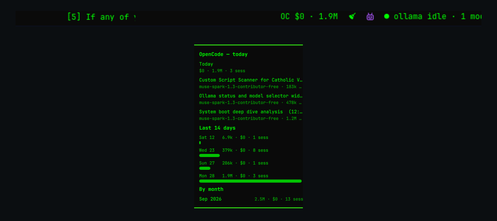
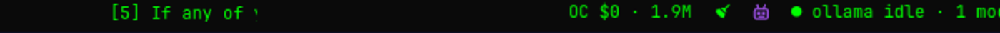
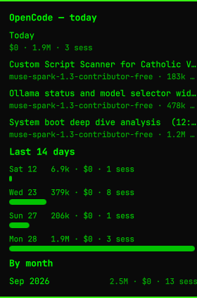

# OpenCode Metrics for Omarchy

Live OpenCode cost and token usage for today, straight in the Omarchy 4 bar.
Reads your local OpenCode sqlite store — no network, no API keys, no daemon.



## At a glance

The bar shows today's spend and tokens, e.g. `OC $0 · 1.9M`:



Left-click opens the details panel — today's sessions, a last-14-days bar
chart, and totals by month:



## Features

- **Today in the bar** — spend (`$0.42`), tokens (`497k`), or both; short
  `OC n/a` state instead of a blank widget when there is nothing to read.
- **Session breakdown** — up to 10 of today's sessions with title, model,
  tokens, cost, and last-active time; also in the hover tooltip.
- **History** — last-14-days token bars scaled to the busiest day, plus
  per-month totals.
- **Fast when open, calm when closed** — polls every 3 seconds normally,
  every 1 second while the panel is open.
- **Private by design** — read-only queries against your own machine;
  malformed data is sanitized before display and one bad read never blanks
  the bar.

## Install

```bash
omarchy plugin add https://github.com/VinishAbraham/omarchy-opencode-metrics.git --enable
```

The widget defaults to the right bar section. Omarchy stores its settings and
placement in `~/.config/omarchy/shell.json`.

Requirements on the machine: `sqlite3` CLI and `python3` (both used only to
read the local database).

## What it shows

- Bar read-out, e.g. `OC $0.42 · 497k` — today's spend and tokens.
- Hover tooltip with per-session breakdown.
- Left-click panel: today's sessions, a last-14-days bar chart, and totals
  by month.

When OpenCode isn't installed or the database is missing/locked, the widget
shows `OC n/a` instead of blanking — no errors, no popups.

## How it works

`scripts/ocmetrics` queries `$HOME/.local/share/opencode/opencode.db`
(read-only) and emits one JSON line; the widget polls it (default every
3 seconds, every 1 second while the panel is open). Override the database
path with the `OPENCODE_DB` environment variable.

Nothing leaves your machine. The plugin creates no services, caches,
credentials, or files outside Omarchy's normal plugin settings.

## Settings

Use Omarchy's bar settings UI, or set values directly:

```bash
omarchy bar set vinishabraham.opencode-metrics refreshIntervalSec 3
omarchy bar set vinishabraham.opencode-metrics showCost true --json
omarchy bar set vinishabraham.opencode-metrics showTokens true --json
```

| Setting | Default | Range | Purpose |
|---|---:|---:|---|
| `refreshIntervalSec` | 3 | 1–60 | Seconds between store reads |
| `showCost` | `true` | boolean | Show today's spend in the bar |
| `showTokens` | `true` | boolean | Show today's tokens in the bar |

## Remove

```bash
omarchy plugin remove vinishabraham.opencode-metrics
```

Omarchy removes the bar entry before uninstalling the plugin. No separate
cleanup is needed.

## Development

```bash
omarchy plugin validate .
./scripts/ocmetrics
```

The second command prints one JSON reading to stdout for a quick smoke test.

## License

MIT — see [LICENSE](LICENSE).
